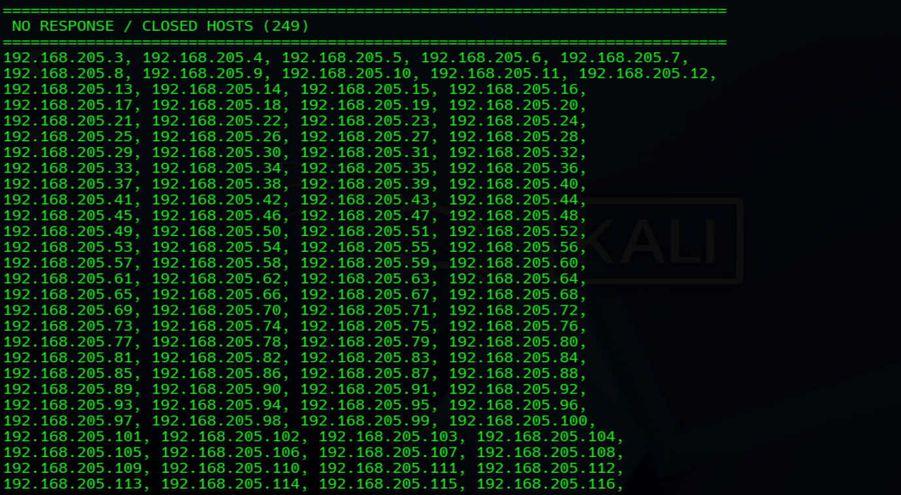
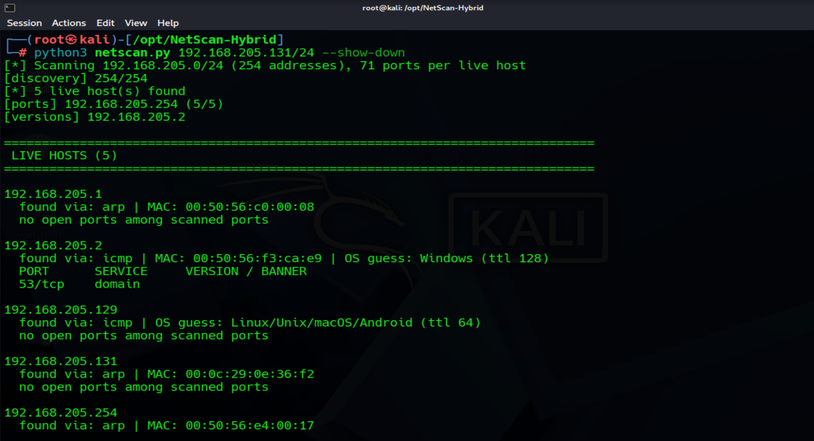
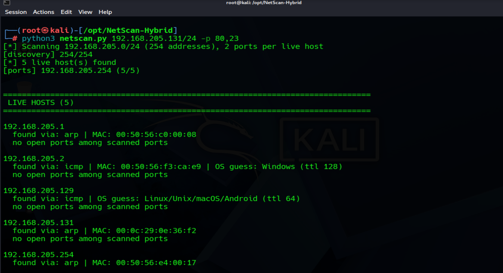

<div align="center">

# 🔍 NetScan

**A fast, hybrid network scanner for Linux, written in pure Python.**

Scan a whole network block and instantly see which devices are **up**, which are **down**, what **ports** are open, and what **software versions** are running. Version 2 adds selectable discovery modes (**ICMP, TCP, ARP, UDP**) so you can compare how each method finds hosts.


</div>

---

## ✨ Features

- 🌐 **Scan a full network block**: give it a CIDR range like `192.168.1.0/24` and it checks every address.
- 🟢 **Live vs. down hosts**: clearly shows which devices respond and which don't.
- 🧠 **Hybrid host discovery**: combines **ICMP ping**, **TCP probes** and **ARP**, so even devices that block ping are found.
- 🎛️ **Selectable discovery modes (new in v2)**: run **ICMP-only**, **TCP-only**, **ARP-only**, **UDP-only**, **hybrid** or **all** with a single `--mode` option.
- 📡 **Real ARP and UDP discovery (new in v2)**: ARP mode forces the kernel to ARP every address; UDP mode sends protocol probes (DNS, NTP, NetBIOS, SNMP, SSDP, mDNS) and detects ICMP port-unreachable replies.
- ⚡ **Discovery-only scans (new in v2)**: skip port scanning to measure discovery on its own.
- 🚪 **Open port detection**: a fast async scanner with your choice of common ports, a custom list, a range, or all 65535.
- 🏷️ **Service and version detection**: grabs banners to identify software such as OpenSSH, Apache/nginx, FTP, SMTP, MySQL and more.
- 🔬 **Optional nmap engine**: add `--nmap` for deeper version detection.
- 🖥️ **Extra device info**: hostname, MAC address and an OS guess for every live host.
- 💾 **Export results** to JSON or CSV. JSON now includes the run settings and discovery time, so every result file documents how it was produced.
- 📦 **Zero pip dependencies**: uses only the Python standard library.

---

## 📥 Installation

```bash
# 1. Clone the repo
git clone https://github.com/awaiskhan1231919/NetScan-Hybrid.git
cd NetScan-Hybrid

# 2. Install system requirements (Debian / Ubuntu / Kali)
sudo apt update && sudo apt install -y python3 iputils-ping nmap
```

> `nmap` is optional. It is only needed for the `--nmap` option.
> Run with `sudo` for `--mode arp`, `hybrid` and `all` so the ARP cache can be flushed before the scan (see [Notes and limitations](#-notes-and-limitations)).

---

## 🚀 Usage

Find your network block first:

```bash
ip -4 addr show      # e.g. inet 192.168.1.25/24  ->  scan 192.168.1.0/24
```

Run a basic scan (hybrid mode, the default):

```bash
python3 netscan.py 192.168.1.0/24
```

### 🎛️ Discovery modes

| Mode | How it finds hosts |
|---|---|
| `icmp` | ICMP echo (ping) only |
| `tcp` | TCP connect probes only. An open port or a refusal (RST) both prove the host is up |
| `arp` | Forces the kernel to send real ARP requests to every address, then reads the ARP table |
| `udp` | Sends protocol probes (DNS, NTP, NetBIOS, SNMP, SSDP, mDNS) and two closed-port probes. A reply, or an ICMP port-unreachable, proves the host is up |
| `hybrid` | ICMP, then TCP, then the ARP table (the original NetScan behaviour, **default**) |
| `all` | Everything in `hybrid`, plus UDP |

### Common examples

| Goal | Command |
|---|---|
| ICMP-only discovery | `python3 netscan.py 192.168.1.0/24 --mode icmp --discovery-only` |
| TCP-only discovery | `python3 netscan.py 192.168.1.0/24 --mode tcp --discovery-only` |
| ARP-only discovery | `sudo python3 netscan.py 192.168.1.0/24 --mode arp --discovery-only` |
| UDP-only discovery | `python3 netscan.py 192.168.1.0/24 --mode udp --discovery-only` |
| Hybrid discovery | `sudo python3 netscan.py 192.168.1.0/24 --mode hybrid --discovery-only` |
| Save a run for later analysis | `sudo python3 netscan.py 192.168.1.0/24 --mode icmp --discovery-only --json icmp_run1.json` |
| Scan ports 1-1024 | `python3 netscan.py 192.168.1.0/24 -p 1-1024` |
| Scan specific ports | `python3 netscan.py 192.168.1.0/24 -p 22,80,443,8080` |
| Scan all ports (slow) | `python3 netscan.py 192.168.1.0/24 -p all` |
| List the down hosts too | `python3 netscan.py 192.168.1.0/24 --show-down` |
| Deeper version detection | `python3 netscan.py 192.168.1.0/24 --nmap` |
| Save results | `python3 netscan.py 192.168.1.0/24 --json out.json --csv out.csv` |
| Skip ping (ping-blocking hosts) | `python3 netscan.py 192.168.1.0/24 --no-ping` |
| Slower but more reliable | `python3 netscan.py 192.168.1.0/24 -t 2 -c 200` |
| Longer UDP wait | `python3 netscan.py 192.168.1.0/24 --mode udp --udp-timeout 3` |

### Options

| Option | Description |
|---|---|
| `target` | Network block in CIDR form, e.g. `192.168.1.0/24` |
| `-m, --mode` | Discovery method: `icmp`, `tcp`, `arp`, `udp`, `hybrid` (default) or `all` |
| `-p, --ports` | `top` (default), `all`, or a list/range like `22,80,8000-9000` |
| `-t, --timeout` | ICMP/TCP timeout in seconds (default `1.0`) |
| `--udp-timeout` | UDP probe timeout in seconds (default `1.5`) |
| `--arp-wait` | Seconds to wait for ARP replies in `arp` mode (default `2.0`) |
| `-c, --concurrency` | Parallel connections (default `500`) |
| `--discovery-only` | Only find live hosts: skip port scan and version detection |
| `--nmap` | Use nmap `-sV` for deeper version detection |
| `--no-ping` | Skip ICMP in `hybrid`/`all`; rely on the other methods |
| `--no-flush` | Do not flush the ARP cache before `arp`/`hybrid`/`all` |
| `--show-down` | List the IPs that did not respond |
| `--json FILE` | Save full results and run settings as JSON |
| `--csv FILE` | Save results as CSV (includes a `found_via` column) |
| `--force` | Allow scanning more than 65,536 addresses |

---

## 📸 Example output

*(Illustrative sample. Your results will differ.)*

```
==============================================================================
 LIVE HOSTS (2)   mode: hybrid   discovery time: 3.42s
==============================================================================

192.168.1.1  (router.lan)
  found via: icmp | MAC: aa:bb:cc:dd:ee:ff | OS guess: Linux/Unix/macOS/Android (ttl 64)
  PORT      SERVICE     VERSION / BANNER
  22/tcp    ssh         OpenSSH 8.9p1 Ubuntu
  80/tcp    http        nginx/1.18.0

192.168.1.20
  found via: tcp
  no open ports among scanned ports

==============================================================================
 NO RESPONSE / CLOSED HOSTS (252)
==============================================================================
 (use --show-down to list them)

Done: 2 up, 252 down, 2 open ports in 14.3s (discovery 3.42s)
```

### Evidence screenshots

- About the image: This screenshot shows the `NO RESPONSE / CLOSED HOSTS` section for a `/24` subnet, where many IP addresses are listed as offline. It demonstrates NetScan's ability to distinguish reachable hosts from non-responding devices.

  

- About the image: This screenshot shows the `LIVE HOSTS` section, listing active devices with their discovery method, MAC address, and OS guess. It confirms NetScan can detect online hosts and gather useful host metadata.

  

- About the image: This screenshot shows a live host scan with open ports and detected services. It demonstrates NetScan's ability to find active services such as `53/tcp` and identify what is running.

  

---

## ⚙️ How it works

1. **Discovery**: depends on `--mode`.
   - `icmp`: one ping per address.
   - `tcp`: connect probes to common ports (80, 443, 22, 445, 139, 135, 3389, 53, 21, 23, 8080, 5900). A connection or a refusal means the host is up.
   - `arp`: a one-byte UDP datagram is sent to each address, which makes the kernel broadcast an ARP request. Hosts that answer get a completed entry in the ARP table, which NetScan reads.
   - `udp`: protocol probes to ports 53, 123, 137, 161, 1900 and 5353, plus two closed ports. Any reply, or an ICMP port-unreachable, marks the host as up.
   - `hybrid`: ICMP first, then TCP for hosts that did not answer, then the ARP table for anything still missing.
   - `all`: the same as `hybrid`, plus UDP.
2. **Port scan**: live hosts are scanned with an async TCP connect scanner (skipped with `--discovery-only`).
3. **Version detection**: open ports are probed for banners and parsed into software names and versions (optionally refined by nmap).
4. **Report**: results are printed in a clean summary and can be exported to JSON or CSV.

---

## 🔬 Research use

Version 2 was built to support a small research study that asks: **does hybrid discovery (ICMP + TCP + ARP) find more hosts than ICMP-only, TCP-only, ARP-only or UDP-only discovery?**

The planned method:

- Build a ground-truth list of devices known to be online on a home network and in a VM lab.
- Run each mode against the same network, three times each, and compare against the reference tool Nmap (Zenmap).
- Record true positives, false negatives, false positives and discovery time, then calculate precision, recall and average time per method.
- Repeat under a second condition (for example, host firewall on, or a sleeping device) and test the effect of the timeout setting.

Results will be added to this repository once the experiments are complete.

---

## 📝 Notes and limitations

- **Use `sudo` for ARP, hybrid and all modes.** Root is needed to flush the ARP cache before the scan. Without a flush, stale entries from earlier traffic can be counted as live hosts.
- **ARP works only on the local subnet.** NetScan warns you if the target is not directly connected.
- **Large ARP sweeps.** The Linux neighbour table defaults to about 1024 entries, so keep ARP sweeps to a `/24`.
- **Passive entries.** A device that sends its own ARP broadcast can appear in the ARP table without being probed.
- **UDP is the least reliable method.** Many devices stay silent on UDP, and Linux rate-limits ICMP port-unreachable replies.
- **OS guessing uses TTL only**, so treat it as a rough hint.
- **TCP scanning only** for open ports. UDP port scanning is not implemented yet.

---

## 🗒️ Changelog

**v2.0**
- Added `--mode` with `icmp`, `tcp`, `arp`, `udp`, `hybrid` and `all`.
- ARP mode now sends real ARP requests instead of only reading the existing cache.
- Added UDP discovery with protocol probes and ICMP port-unreachable detection.
- Added `--discovery-only`, `--udp-timeout`, `--arp-wait` and `--no-flush`.
- JSON export now includes run settings and discovery time; CSV has a `found_via` column.
- The report now shows the mode and the discovery time.

**v1.0**
- Hybrid discovery (ICMP, TCP, ARP cache), async port scan, banner-based version detection, optional nmap, JSON/CSV export.

---

## ⚠️ Legal disclaimer

This tool is for **educational purposes and authorized security testing only**. Only scan networks and devices that you **own** or have **explicit written permission** to test. The author is not responsible for misuse.

---

## 🤝 Contributing

Ideas and pull requests are welcome. Feel free to open an issue for bugs or feature requests (IPv6 support, UDP port scanning, MAC vendor lookup, and more).

## 📄 License

Released under the [MIT License](LICENSE).

---

<div align="center">

If you find this project useful, please give it a ⭐ on GitHub!

</div>
